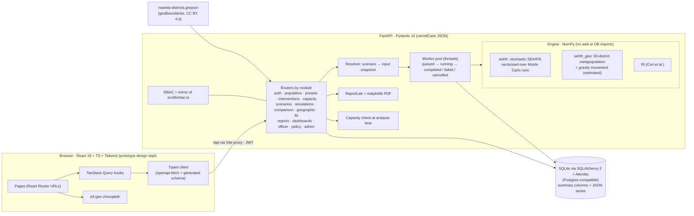

# EpiSim MVP

EpiSim is a decision-support demo for health decision-makers in Rwanda. You configure an epidemic
scenario, simulate it, analyse the results and refine it. It covers Ebola and Marburg on a stochastic
SEIHFR model, nationally or across Rwanda's 30 districts.

> **This is a demonstration.** Results are **scenario estimates, not forecasts**. The model has not been
> calibrated or reviewed by an epidemiologist, the disease parameters are provisional, the seed data is
> illustrative and movement between districts is estimated. The in-app **About this demo** page lists what is
> real, estimated and mocked; `docs/DECISIONS.md` lists every assumption and deviation.

## Quick start

Requirements: Python 3.11+, Node 18+ (tested with Python 3.14 and Node 24), `make`.

```bash
make dev        # first run installs everything, migrates, seeds, then starts both servers
```

- Frontend: <http://localhost:5173> (if the port is taken: `make dev FRONTEND_PORT=5174`)
- API and OpenAPI docs: <http://localhost:8000/docs>

| Command | What it does |
|---|---|
| `make setup` | Backend virtualenv, `npm install`, `.env` from `.env.example`, migrations, seed (only if the database is empty) |
| `make dev` | Backend on :8000 (auto-reload) and frontend on :5173 with `/api` proxied; stops both if either exits |
| `make test` | ruff, pytest (engine + API + the P0 demo path through the API), TypeScript typecheck, vitest |
| `make seed` | Re-run the idempotent seed, including five real engine runs (about 5 s) |
| `make reset-db` | Delete the SQLite database and seed again |
| `make openapi` | Export the OpenAPI schema and regenerate the typed frontend client (`frontend/src/api/schema.d.ts`) |
| `make backtest` | Run the Ebola back-test (downloads WHO-derived counts; see `docs/backtest/RESULTS.md`) |

Optional browser check of the whole demo path (needs Playwright): see `tools/e2e/demo_path.py`.

## Demo accounts

The MFA screen is a mock: press **Continue**. In demo mode, the role switcher in the top bar signs you in as
that role's demo user.

| Role | Email | Password |
|---|---|---|
| Epidemiologist (analyst) | `epidemiologist@rbc.gov.rw` | `epi123` |
| Epidemiologist (second, approves reports) | `s.icyeza@rbc.gov.rw` | `epi123` |
| Public Health Officer | `officer@who.int` | `officer123` |
| Policy Maker | `policymaker@moh.gov.rw` | `policy123` |
| Administrator | `admin@moh.gov.rw` | `admin123` |

These are demo credentials for a local SQLite database. Change `JWT_SECRET` and the passwords before any
shared deployment.

## Demo script (about 5 minutes)

1. **Sign in** as the Epidemiologist (`epidemiologist@rbc.gov.rw`). Point out the demo ribbon and *About this demo*.
2. **Population Data** (Data Management): datasets with versions. *Import* → *Try an illustrative sample file*.
   The server validates every row (two rows are deliberately wrong) and the import runs as a background job.
3. **Disease Presets**: Ebola and Marburg with their SEIHFR values, each with its reference. Marburg (and,
   until reviewed, Ebola) shows *Provisional*. Built-ins are read-only; *Clone as custom* to edit.
4. **Intervention Library**: types show which model lever they move; packages have time windows.
5. **Scenario Library**: open *Ebola Rubavu · contact tracing + isolation*. It pins dataset version, preset and package.
6. **Simulations**: pick *Ebola national · Rubavu seed · current response*, set **10** initial cases
   (late detection), choose **Geographic (30 districts)**, seed district **Rubavu**, *Run simulation*. The run is
   queued, then runs on the server in about a second (*Cancel* is available while a run is queued or running).
7. **View full results**: fan charts (median and 5–95% band of 200 runs), chance of take-off, cases, deaths,
   peak beds, health-worker share, Rt over the run, and *What this run used* (seed, engine version, dataset
   version, preset reference). Choose a **capacity profile**: the chance beds run out is computed now, not at run time.
8. **Compare**: add the seeded *RUN-0100*. The page warns that the runs are not like-for-like and shows the
   differences from the baseline. *Copy link* shares the exact comparison.
9. **Map**: Geographic Spread with capacity *MoH isolation beds · Q3 2026 (by district)*. Play the timeline,
   switch *Cases* / *Beds vs capacity*, click Rubavu (cases with range, peak day, "Beds run out from day N" or
   "Within capacity"), try *Start response on day 20* (a labelled preview), toggle movement lines (estimated).
10. **Add to report** from the results page: save the draft and *Submit for approval*. Approving your own report is refused.
11. **Switch user** to `s.icyeza@rbc.gov.rw` (or use the role switcher) and **Approve** it.
12. **Switch to Policy Maker**: Reports shows approved reports only. Open it and download the **PDF**, which carries
    the estimate label, provisional flags, the fan chart, inputs and limitations. *Scenarios* shows the approved
    scenario with its real run.

## Architecture



- **Reproducible runs**: every run stores its seed, engine version and a snapshot of every resolved input
  (dataset version and district populations, preset values, intervention lever windows, health-worker settings).
- **One engine** (docs D1). The prototype's in-browser engines are gone from the app. The original TypeScript engine
  lives in `tools/reference-engine/` only to generate the parity test's reference outputs.
- **Model dispatch** by `model_type` (`seihfr`, `seihfr_geo`). Adding a disease means adding a preset, not code.
- **Capacity is a check, not an input**: per-run peak bed demand is stored, so the chance beds run out and the
  "beds run out from day N" line are computed for whichever capacity profile you pick.

## Deploying

The app ships as **one Docker container**: the image builds the frontend, and FastAPI serves it next to
`/api` on port 8000. `deploy/start.sh` runs migrations, seeds an empty database and starts **one** uvicorn
process. Keep it to one process: simulations run in an in-process thread pool on SQLite. Mount a persistent
volume at **`/data`**, which holds the SQLite database and generated PDFs.

```bash
docker build -t episim-mvp .
docker run -p 8000:8000 -v episim-data:/data -e JWT_SECRET=$(python3 -c 'import secrets;print(secrets.token_urlsafe(48))') episim-mvp
```

| Variable | Default in the image | Notes |
|---|---|---|
| `JWT_SECRET` | dev default | **Set it.** Required when `DEMO_MODE=false` |
| `DEMO_MODE` | `true` | Demo ribbon and role switcher (anyone can sign in as any role) |
| `WORKER_THREADS` | `1` | Concurrent simulations |
| `DATABASE_URL` / `FILES_DIR` | `/data/episim.db` / `/data/files` | |
| `CORS_ORIGINS` | localhost:5173 | Only needed if the frontend is hosted on another domain |

**Fly.io** (`fly.toml`): `fly launch --no-deploy --copy-config` (pick a unique app name),
`fly volumes create episim_data --size 1 --region jnb`, `fly secrets set JWT_SECRET=...`, `fly deploy`.
**Render** (`render.yaml`, free plan): *New → Blueprint* → pick the repo. Free has no disk, so data resets to the seed on each sleep or deploy; a disk needs the Starter plan.

## Repository layout

```
backend/app/simulation/   NumPy engine (seihfr, seihfr_geo, levers, movement, Rt, analysis)
backend/app/api/          FastAPI routers, grouped by documentation module
backend/app/services/     resolver, worker, comparison, geographic analysis, PDF, audit
backend/app/models/       SQLAlchemy models; backend/alembic/ migrations
backend/app/data/         district boundaries + illustrative seed JSON
backend/tests/            API tests, engine tests (tests/simulation), P0 demo-path test
frontend/src/api/         generated OpenAPI types, client, query hooks per module
tools/reference-engine/   original TypeScript engine + reference-output generator
tools/backtest/           Ebola back-test against the 2014 West Africa reports
tools/e2e/                headless-browser walk through the P0 demo path
docs/                     DECISIONS.md, API.md, backtest results, module documentation
```

## What is real, estimated and mocked

| Real | Estimated or provisional | Mocked or illustrative |
|---|---|---|
| Stochastic SEIHFR engine run server-side (200 Monte Carlo runs, seeded, reproducible) | Disease parameters (Marburg weakest; Ebola not yet reviewed for EpiSim) | MFA screen |
| Rwanda's 30 district boundaries (geoBoundaries, CC BY 4.0) | Intervention effect sizes (placeholders) | All seed records (labelled *Illustrative*) |
| Rt estimation (Cori et al. 2013) | Movement between districts (gravity model, 2% time-away assumption) | Some admin panels: system-health charts and logs, several settings tabs (labelled *Demo data*) |
| Auth (argon2, JWT), server-side RBAC, audit log | Border importation risk labels (shown, not modelled by default) | Capacity-page gap preview (labelled illustrative example) |
| CSV import with validation, background jobs, PDF reports, approval workflow | District populations (2022 census, approximate) and bed counts | No real patient data anywhere |

## Known gaps

- **Not validated.** The back-test (`docs/backtest/RESULTS.md`) shows large misses as well as hits.
  No accuracy claims are made.
- **Open decisions** still need an owner (`docs/DECISIONS.md`, marked **needs review**). They include:
  - the lever constants and combination rule;
  - the movement share;
  - the what-if response values;
  - NISR district codes;
  - capacity access for Epidemiologists (D7);
  - Geographic access for officers and policy makers (D8).
- **Worker and storage:** the worker is in-process. A server restart marks in-flight runs as failed. What-if
  previews and PDF exports run synchronously.
- **Capacity data entry:** per-district beds can't be edited in the UI yet; they come from the seed.
- **Imports and data flows:**
  - A dataset imported from the sample file is not flagged *Illustrative*. Only seeded records are.
  - Hospital Tracker entries don't feed the Rt case datasets yet.
- **Frontend tests:** there are no frontend unit tests. The UI is covered by the TypeScript typecheck and the
  optional `tools/e2e` browser script.
- **Auth storage:** the demo stores the JWT in `localStorage`. Use httpOnly cookies before any real deployment.
- **Demo mode is not for public servers.** With `DEMO_MODE=true` the role switcher (`POST /api/auth/demo-login`)
  signs anyone in as any role, including admin, without a password. With `DEMO_MODE=false` the server refuses the
  development JWT secret and demo accounts cannot sign in.
- **Uploads:** CSV uploads are read into memory before the 50 MB limit is checked.

## Credits

District boundaries: geoBoundaries (gbOpen, RWA ADM2), CC BY 4.0. Back-test counts: WHO situation reports, as
compiled by Caitlin Rivers (`cmrivers/ebola`). UI design: the original Magic Patterns prototype.
