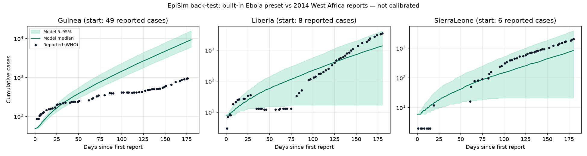

# Back-test: Ebola preset vs the 2014 West Africa outbreak

Generated by `tools/backtest/backtest_ebola.py` (engine `seihfr-0.1.0`, 200 runs, seed 2026).

**Data:** WHO situation reports as compiled in Caitlin Rivers' `cmrivers/ebola` `country_timeseries.csv` (cumulative reported cases: confirmed, probable and suspected).

**Method:** the built-in Ebola preset as seeded, with no fitting and no interventions, started on each country's first report with the first reported count as the initial cases. Every later report up to day 180 is compared with the model's 5–95% band of cumulative cases.

| Country | Start cases | Reports compared | Inside 5–95% band | Day ~60: reported vs median | Day ~120 | Day ~180 |
|---|---|---|---|---|---|---|
| Guinea | 49 | 60 | 8/60 (13%) | 248 vs 394 (day 51) | 415 vs 2,354 (day 120) | 942 vs 8,486 (day 176) |
| Liberia | 8 | 57 | 40/57 (70%) | 12 vs 70 (day 57) | 249 vs 341 (day 118) | 3,458 vs 1,365 (day 180) |
| SierraLeone | 6 | 46 | 38/46 (83%) | 12 vs 14 (day 19) | 525 vs 222 (day 118) | 2,021 vs 827 (day 180) |

### Sensitivity: start from reported cases minus reported deaths

Added after the first run, because Guinea's first report (49 cases) already included 29 deaths, and treating every reported case as still infectious overstates the start. Shown alongside the primary result, not instead of it.

| Country | Start cases | Reports compared | Inside 5–95% band | Day ~60: reported vs median | Day ~120 | Day ~180 |
|---|---|---|---|---|---|---|
| Guinea | 20 | 60 | 25/60 (42%) | 248 vs 156 (day 51) | 415 vs 907 (day 120) | 942 vs 3,281 (day 176) |
| Liberia | 2 | 57 | 32/57 (56%) | 12 vs 10 (day 57) | 249 vs 17 (day 118) | 3,458 vs 18 (day 180) |
| SierraLeone | 1 | 46 | 7/46 (15%) | 12 vs 2 (day 19) | 525 vs 2 (day 118) | 2,021 vs 2 (day 180) |

## Reading the primary result honestly

- **Guinea:** 41 reports fell below the band and 11 above it. At day 176 the reported total was 942 against a model median of 8,486 (ratio 0.11), below the band.
- **Liberia:** 14 reports fell below the band and 3 above it. At day 180 the reported total was 3,458 against a model median of 1,365 (ratio 2.53), inside the band.
- **SierraLeone:** 8 reports fell below the band and 0 above it. At day 180 the reported total was 2,021 against a model median of 827 (ratio 2.44), inside the band.

## Caveats

- The preset values are provisional and have not been reviewed for EpiSim (docs section 10).
- The model run has no interventions, while the real response changed over the period.
- Each country is treated as one well-mixed population; the real outbreak spread between places and across borders.
- Reported counts were revised, mix case definitions and lag behind onset.
- The two start rules give very different answers (Liberia and Sierra Leone die out early in most runs when started from 1–2 cases). Early-outbreak projections are highly sensitive to the starting count and to chance; treat any single band with caution.
- This is one back-test on one outbreak. It does not validate the model.
